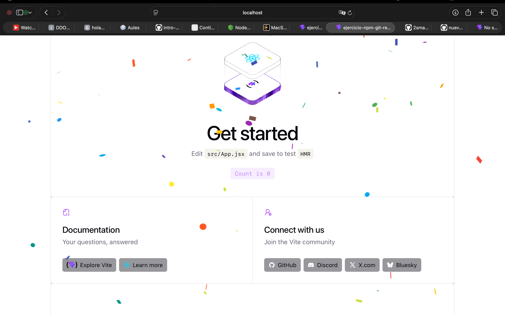
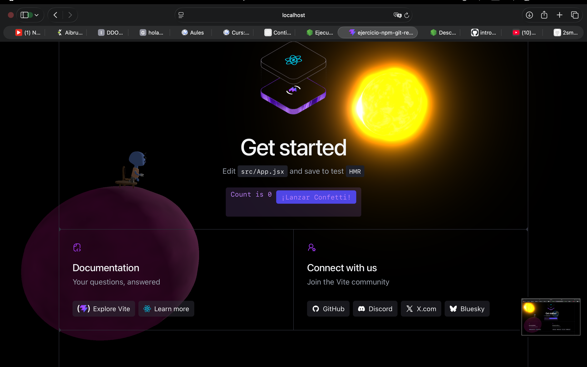

# Mi proyecto React

En este proyecto he trabajado con React y Vite. He probado dos librerías para hacer efectos de confeti y también he añadido una escena 3D con un planeta y un OVNI.

## Capturas

### React Confetti

### Canvas Confetti

### Escena 3D

## Pregunta sobre node_modules

Si `node_modules/` está excluida, ¿borrar una dependencia hace alguna acción sobre el repositorio? ¿Cuál?

Sí , al borrar una dependencia con `npm uninstall`, si se elimina de `node_modules` y también se actualizan los archivos `package.json` y `package-lock.json`, estos cambios sí se pueden subir al repositorio con Git.

## Web publicada

Enlace: pendiente de publicar.
